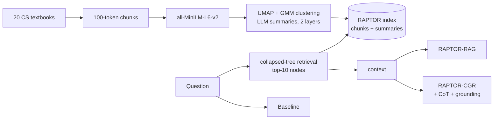

# RAPTOR-CGR: Context-Grounded Reasoning for CS Exercise Answering

**Effective Retrieval-Augmented Generation for LLM Reasoning in Computer Science Exercise Answering**
COMP4913 Capstone Project, Department of Computing, The Hong Kong Polytechnic University (2026)
Leung Wai Kit (22094868D) · Supervisor: Dr HUANG Xiao

📄 [Final report](docs/FYP_Final_Report_22094868D.pdf) · 🖥️ [Presentation](docs/FYP_Presentation.pdf) · 📝 [Summary](docs/FYP_Summary_22094868D.docx)

---

LLMs often give fluent answers to university-level computer science questions without sound reasoning. **RAPTOR-CGR** combines
[RAPTOR](https://arxiv.org/abs/2401.18059) hierarchical retrieval over CS textbooks with **chain-of-thought prompting** and
**context grounding**. It is evaluated on all **1,018 questions** of [GraphRAG-Bench](https://arxiv.org/abs/2506.02404), which covers 16 CS topics and 5 question types.

## Versions

| | v1: submitted report (tag [`v1-submitted`](../../tree/v1-submitted)) | **v2: this branch** |
|---|---|---|
| Retrieval corpus | Built from the benchmark items (question, rationale, answer) | **The 20 official GraphRAG-Bench textbooks.** No benchmark question, answer or rationale is indexed, and this is checked by `check_leakage.py`. |
| Prompts | A different prompt and temperature for each pipeline | One shared format and temperature 0. Each pipeline adds exactly one ingredient. |
| Answer checking | Exact string match (`TRUE` ≠ `True`). An empty multi-select answer earned 0.5. Only the first line of an answer was read. | Normalised matching, letters mapped back after option shuffles, empty answers scored 0, full answers read |
| Judge | The answering model, grading without the question | Configurable model (a different family is recommended). It sees the question and replies in JSON. Every judgment is saved. |
| Guessing checks | – | Chance levels, unsupported-correct rate, option-shuffle consistency, judge agreement |
| Results | `results/v1/` | `results/` (written by the commands below) |

## How an answer is checked

Every benchmark question comes with a **reference answer** and an **expert rationale**. The model must reply as `RATIONALE: … ANSWER: …`.

| Score | Multiple choice / True-False | Multi-select | Fill-in-blank | Open-ended |
|---|---|---|---|---|
| **Answer** | exact match (normalised) | 1 = all letters, 0.5 = a correct non-empty subset, else 0 | exact match = 1, otherwise LLM judge | LLM judge: 0 / 0.5 / 1 |
| **Rationale** | LLM judge compares the reasoning with the expert rationale: 0 / 0.5 / 1 (all types) | | | |
| **AR** | GraphRAG-Bench combination: correct answer + correct reasoning = 1, correct answer + partial reasoning = 0.5, wrong answer + correct/partial reasoning = 0.5/0.25, otherwise 0 | | | |

18 benchmark items have no expert rationale. They count for answer accuracy only.

### Real understanding or a lucky guess?

A correct letter alone does not prove understanding, so `make_report.py` also reports:

- **Chance level:** random guessing scores about 25% on multiple choice and 50% on true/false.
- **AR score and unsupported-correct rate:** a correct answer only scores fully when the reasoning matches the expert rationale. The report also gives the share of answers that are correct but whose rationale was judged wrong.
- **Option-shuffle consistency:** multiple-choice and multi-select questions are asked again with the options in a different order (`--shuffle-seed`). A model that understands picks the same option wherever it is placed; a positional guess does not survive the shuffle.
- **Judge reliability:** run `evaluate.py` with two different judge models. The report shows their agreement and Cohen's κ. Using a judge from a different model family avoids self-preference bias.

## Method



| Pipeline | Context | Chain of thought | Context grounding |
|---|---|---|---|
| `baseline` | – | – | – |
| `pure` (RAPTOR-RAG) | ✓ | – | – |
| `cgr` (**RAPTOR-CGR**) | ✓ | ✓ | ✓ (cite evidence, say when the context is insufficient) |
| `selfcritique` (extra ablation) | ✓ | – | – (a second call reviews the answer) |

All prompts are in [`src/prompts.py`](src/prompts.py). All pipelines use temperature 0. Retrieval is computed once (`results/contexts.jsonl`), so every RAPTOR pipeline sees exactly the same evidence.

## Run it

```bash
python3.11 -m venv .venv && source .venv/bin/activate
pip install -r requirements.txt
cp .env.example .env              # add an API key (any OpenAI-compatible endpoint)
```

```bash
python src/download_data.py                        # 20 textbooks (~36 MB); verifies the 1,018 questions
python src/build_tree.py                           # RAPTOR trees + index (resumable)
python src/retrieval.py                            # retrieved context for every question
python src/check_leakage.py                        # proves no answer key is retrievable
python src/run_pipeline.py --pipeline baseline
python src/run_pipeline.py --pipeline pure
python src/run_pipeline.py --pipeline cgr
python src/run_pipeline.py --pipeline selfcritique
python src/run_pipeline.py --pipeline cgr --shuffle-seed 1      # guessing check (MC + MS)
python src/evaluate.py                             # judge = JUDGE_* in .env (default: answering model)
python src/make_report.py                          # results/scores.json, results/tables/
```

Every step can be resumed: rerunning a command skips finished work and retries failures. `--limit N` gives a quick test, and `--workers N` sets how many requests run in parallel (default 8). To measure judge agreement, set a second `JUDGE_MODEL` in `.env`, run `evaluate.py` again, then run `make_report.py`.

### Cost and time (estimate for one full v2 run)

| Step | API calls | Tokens (in / out) | Time (8 parallel requests) |
|---|---|---|---|
| Build RAPTOR trees (one-off) | ≈ 13,600 summaries | ≈ 7.2 M / 1.4 M | 1–2 h |
| Answer: 4 pipelines + shuffle check | ≈ 5,400 | ≈ 6.5 M / 1.0 M | ≈ 1 h |
| Evaluate (one judge) | ≈ 5,500 | ≈ 2.5 M / 0.1 M | ≈ 0.5 h |
| **Total** | **≈ 24,500** | **≈ 16 M / 2.5 M** | **≈ 3–4 h** |

At DeepSeek `deepseek-flash` prices (November 2026) this costs about **US$4–8** in total. Free tiers allow roughly 1,000 requests a day, so a full run would take weeks. Use one model for all answering runs, so that the pipelines stay comparable.

## Web tutor (chat with the textbooks)

A chat website for students: ask a computer science question in English or Chinese and get an answer
grounded in the 20 textbooks. Each answer cites the passages it uses, explains step by step, and
gives algorithms or pseudocode when needed. Maths is rendered with KaTeX.

**How it answers (one request):**
1. The question is embedded locally with `multilingual-e5-small`, so Chinese questions find English passages (~20 ms).
2. The 6 most relevant passages are found among about 38,000 textbook chunks (~20 ms).
3. One streamed LLM call answers from those passages, citing them as [1]–[6].

There is no web search and no multi-step agent loop, so the first words appear in about 1 s and a
full answer usually takes a few seconds.

```bash
python src/download_data.py          # once: the 20 textbooks (kept local, not in git)
python src/build_web_index.py        # once: ~5-10 min, free (local embeddings)
python web/server.py --demo          # try the UI without any API key
python web/server.py                 # real answers: set CHAT_PRIMARY_API_KEY in .env
```

Then open http://127.0.0.1:8000.

**Models:** any OpenAI-compatible API, set in `.env`.

- **Primary (default):** DeepSeek `deepseek-flash`, about US$0.0005 per answer, so US$1 covers about 2,000 answers. It works from Hong Kong.
- **Optional fallback:** for example an OpenRouter `:free` model. It takes over automatically when the primary fails.
- **Not reachable from Hong Kong:** Groq, OpenAI and Google Gemini block Hong Kong IPs. Groq's free `gpt-oss-120b` is very fast, but you can only use it once the server runs outside Hong Kong (see *Future work*).

**Built in:**
- streamed answers
- source cards with the full passage
- follow-up questions (last two exchanges)
- cache for repeated questions
- per-visitor rate limit
- input validation
- dark mode and a mobile layout

No accounts, and questions are not stored.

**Demo it publicly from a Mac (free):** install the tool once with `brew install cloudflared`, then, with the server running, run
`cloudflared tunnel --url http://127.0.0.1:8000` ([Cloudflare Tunnel](https://developers.cloudflare.com/cloudflare-one/connections/connect-networks/do-more-with-tunnels/trycloudflare/)).
It prints a public `https://….trycloudflare.com` link, which stays up while the Mac and the command keep running.

## Tests (offline, no API key needed)

```bash
python -m unittest discover tests
```

- `test_scoring.py` covers answer parsing, normalisation, multi-select partial credit, option-shuffle mapping, judge parsing and the AR table.
- `test_retrieval.py` checks that the fast numpy retriever returns exactly the same context as RAPTOR's own `TreeRetriever`.
- `test_end_to_end.py` runs the whole workflow with a fake LLM on two textbooks: tree, retrieval, leakage audit, all pipelines (with injected API failures and retry), the shuffle run, evaluation and the report.
- `test_report.py` checks the paired bootstrap and Cohen's kappa.
- `test_web.py` covers the web tutor: retrieval, prompt, cache, follow-ups, provider fallback, interrupted streams, the HTTP API (streaming, validation, rate limit, no leaked errors) and demo mode.

## Repository structure

```
├── src/
│   ├── common.py          paths, settings, dataset helpers, option shuffling
│   ├── llm.py             OpenAI-compatible client: retries, token accounting
│   ├── prompts.py         every prompt (answering, critique, judge)
│   ├── scoring.py         parsing + deterministic scoring + AR
│   ├── download_data.py   textbooks from Hugging Face (pinned revision)
│   ├── build_tree.py      RAPTOR tree per textbook -> flat index
│   ├── retrieval.py       collapsed-tree retrieval for all questions
│   ├── check_leakage.py   answer-key leakage audit
│   ├── run_pipeline.py    baseline / pure / cgr / selfcritique (+ --shuffle-seed)
│   ├── evaluate.py        per-question judgments
│   ├── make_report.py     scores, tables, guessing checks, judge agreement, significance
│   ├── build_web_index.py multilingual chunk index for the web tutor
│   └── chat_engine.py     retrieval + grounded streamed answer + provider fallback
├── web/                   FastAPI server + chat page (HTML/CSS/JS)
├── raptor/                RAPTOR library (vendored, MIT, unmodified)
├── tests/
├── data/graphrag_bench.jsonl   the 1,018 questions (+ book_titles.json)
├── results/               v2 outputs; results/v1/ = submitted version
└── docs/                  report, presentation, summary
```

## Future work

These need money, a long-running server or more time, so they are not done yet:

1. **Full v2 evaluation:** build the RAPTOR trees, answer all 1,018 questions with every pipeline,
   run the shuffle check and judge them (≈ 24,500 API calls, about US$4–8 with `deepseek-flash`, 3–4 h).
   The code and tests are ready; see *Run it*.
2. **RAPTOR answers in the web tutor:** add the RAPTOR cluster summaries to the web index, so that
   broad questions can use chapter-level summaries (≈ US$2 of summarisation, or about two weeks on free quotas).
3. **Always-on hosting:** move from a Mac + Cloudflare Tunnel to a small VPS (about US$4–6/month)
   or to Cloudflare Workers + Vectorize (about US$5/month; the index is larger than the free tier).
   A server outside Hong Kong (e.g. Singapore or Japan) can also use Groq's fast free tier.
4. **Textbook licensing:** the 20 textbooks stay local and are never committed. A public service
   should check the licences, or switch to openly licensed textbooks, before serving passages.
5. **Measured web accuracy:** compare the tutor with a plain LLM on a sample of benchmark questions
   (100 questions fit in one day of the Groq free tier), and publish the numbers on the page.

## Acknowledgements

- **RAPTOR:** P. Sarthi et al., *RAPTOR: Recursive Abstractive Processing for Tree-Organized Retrieval*, ICLR 2024. Code from [parthsarthi03/raptor](https://github.com/parthsarthi03/raptor) (MIT, see `raptor/LICENSE`).
- **GraphRAG-Bench:** Y. Xiao et al., *GraphRAG-Bench: Challenging Domain-Specific Reasoning for Evaluating Graph Retrieval-Augmented Generation*, arXiv:2506.02404, 2025. The questions and textbooks belong to their authors. The questions are included here for reproducibility only, and the textbooks are downloaded from [Hugging Face](https://huggingface.co/datasets/Awesome-GraphRAG/GraphRAG-Bench).

## License

The code is MIT licensed (see [LICENSE](LICENSE)). The GraphRAG-Bench data and the report documents are not covered by this license.
