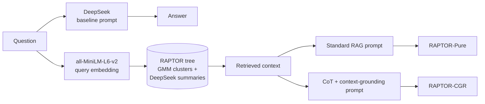

# RAPTOR-CGR: Context-Grounded Reasoning for CS Exercise Answering

**Effective Retrieval-Augmented Generation for LLM Reasoning in Computer Science Exercise Answering**
COMP4913 Capstone Project, Department of Computing, The Hong Kong Polytechnic University (2026)
Leung Wai Kit (22094868D) · Supervisor: Dr HUANG Xiao

📄 [Final report](docs/FYP_Final_Report_22094868D.pdf) · 🖥️ [Presentation](docs/FYP_Presentation.pdf) · 📝 [Summary](docs/FYP_Summary_22094868D.docx)

---

LLMs often give fluent answers to university-level computer science questions without sound reasoning. **RAPTOR-CGR** combines
[RAPTOR](https://arxiv.org/abs/2401.18059) hierarchical retrieval with **Chain-of-Thought prompting** and **context grounding**.
It is evaluated on all **1,018 questions** of [GraphRAG-Bench](https://arxiv.org/abs/2506.02404), which covers 16 CS topics and 5 question types.

## Results

| Pipeline | Answer Accuracy | Rationale Score | AR Score |
|---|---|---|---|
| DeepSeek-Baseline (no retrieval) | 0.7652 | 0.6282 | 0.4794 |
| RAPTOR-Pure (standard RAPTOR-RAG) | 0.7985 | 0.6920 | 0.5707 |
| RAPTOR-SelfCritique *(extra ablation)* | 0.7706 | 0.6228 | 0.5145 |
| **RAPTOR-CGR (proposed)** | **0.8899** | **0.7323** | **0.6390** |

Compared with the baseline, RAPTOR-CGR improves answer accuracy by **+12.5 pts**, rationale score by **+10.4 pts** and AR score by **+16.0 pts**.

**AR score by question type**

| Type | n | Baseline | RAPTOR-Pure | RAPTOR-SelfCritique | RAPTOR-CGR |
|---|---|---|---|---|---|
| FB (Fill-in-blank) | 105 | 0.5167 | 0.7071 | 0.6643 | **0.8119** |
| MC (Multiple choice) | 217 | 0.6613 | 0.7051 | 0.7247 | **0.7638** |
| MS (Multi-select) | 111 | 0.4707 | 0.5901 | 0.6104 | **0.6959** |
| OE (Open-ended) | 269 | 0.1701 | 0.3309 | 0.1636 | **0.4071** |
| TF (True/False) | 316 | 0.6084 | 0.6305 | 0.5854 | **0.6733** |

Per-topic tables and an Excel workbook are in [`results/tables/`](results/tables/). The raw scores are in [`results/scores.json`](results/scores.json).

## Method



| | Baseline | RAPTOR-Pure | RAPTOR-CGR |
|---|---|---|---|
| Retrieved context | – | ✓ | ✓ |
| Step-by-step (CoT) instruction | – | – | ✓ |
| "Answer strictly from the context" constraint | – | – | ✓ |
| Format rules for all 5 question types | partial | partial | ✓ |
| Temperature | 0.2 | 0 | 0.2 |

- **RAPTOR tree:** passages are embedded with `sentence-transformers/all-MiniLM-L6-v2` and clustered recursively with Gaussian Mixture Models (2 layers, threshold 0.5). Each cluster is summarised by DeepSeek. All RAPTOR pipelines share the same pre-built tree (`data/raptor_tree.pkl`).
- **RAPTOR-SelfCritique** is an extra ablation that is not part of the report. The model answers once, then a second call reviews and corrects that answer. It did not beat the single-pass prompts.
- The exact prompts are in [`src/run_baseline.py`](src/run_baseline.py) and [`src/run_raptor.py`](src/run_raptor.py).

### Evaluation metrics

The metrics follow the GraphRAG-Bench evaluator ([`src/evaluate.py`](src/evaluate.py)), with DeepSeek as the judge:

- **Answer score:** exact match for MC and TF. For MS, a correct subset of the answers gets 0.5. For FB and OE, an LLM judge gives 0, 0.5 or 1.
- **Rationale score:** an LLM judge compares the predicted rationale with the expert rationale and gives 0, 0.5 or 1.
- **AR score:** answer and rationale combined. A correct answer with a correct rationale scores 1, a correct answer with a partial rationale 0.5, and a wrong answer with a correct or partial rationale 0.5 or 0.25.

## Repository structure

```
├── src/
│   ├── common.py              # paths, LLM client, dataset helpers
│   ├── run_baseline.py        # Pipeline 1: DeepSeek, no retrieval
│   ├── run_raptor.py          # Pipelines 2-4: --pipeline pure | cgr | selfcritique
│   ├── build_eval_inputs.py   # split questions/predictions by type for the evaluator
│   ├── evaluate.py            # GraphRAG-Bench metrics (LLM-as-judge)
│   └── make_report.py         # CSV / Excel / Markdown tables from scores.json
├── raptor/                    # RAPTOR library (vendored, MIT, unmodified)
├── data/
│   ├── graphrag_bench.jsonl   # 1,018 GraphRAG-Bench questions
│   └── raptor_tree.pkl        # pre-built RAPTOR tree used in all experiments
├── results/
│   ├── raw/                   # model outputs of each pipeline (1,018 each)
│   ├── eval_inputs/           # evaluator-format questions and predictions
│   ├── scores.json            # overall / per-type / per-topic scores
│   └── tables/                # overall, by question type, by topic (+ .xlsx)
└── docs/                      # final report, presentation, summary
```

## Reproduce

```bash
python3.11 -m venv .venv && source .venv/bin/activate
pip install -r requirements.txt
cp .env.example .env        # then put your DeepSeek API key in .env
```

The tables can be regenerated from the stored scores without an API key:

```bash
python src/make_report.py
```

To run the experiments again, run each pipeline and then the evaluator. Every script is resumable, and `--limit N` gives a quick test run:

```bash
python src/run_baseline.py
python src/run_raptor.py --pipeline pure
python src/run_raptor.py --pipeline cgr
python src/run_raptor.py --pipeline selfcritique
python src/build_eval_inputs.py
python src/evaluate.py --force
python src/make_report.py
```

Notes:
- The scripts resume from existing files in `results/raw/`. Move or delete those files to start a fresh run.
- Re-running gives slightly different numbers because of LLM sampling and DeepSeek model updates.
- If `data/raptor_tree.pkl` is deleted, `run_raptor.py` rebuilds the tree. This takes many summarisation calls.

## Acknowledgements

- **RAPTOR:** P. Sarthi et al., *RAPTOR: Recursive Abstractive Processing for Tree-Organized Retrieval*, ICLR 2024. Code from [parthsarthi03/raptor](https://github.com/parthsarthi03/raptor) (MIT, see `raptor/LICENSE`).
- **GraphRAG-Bench:** Y. Xiao et al., *GraphRAG-Bench: Challenging Domain-Specific Reasoning for Evaluating Graph Retrieval-Augmented Generation*, arXiv:2506.02404, 2025. The dataset belongs to its authors and is included here for reproducibility only.
- **DeepSeek** (`deepseek-chat`) is used for answering, summarisation and evaluation.

## License

The code in this repository is MIT licensed (see [LICENSE](LICENSE)). The GraphRAG-Bench data and the report documents are not covered by this license.
