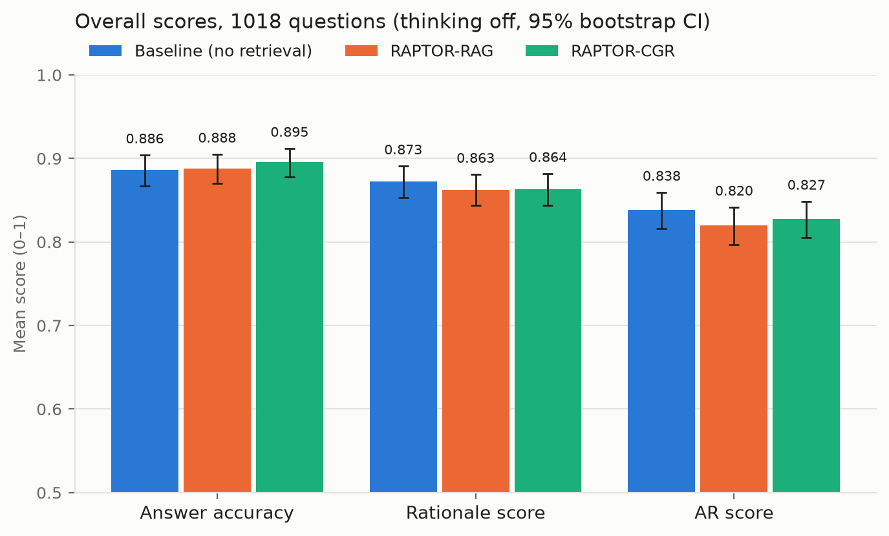
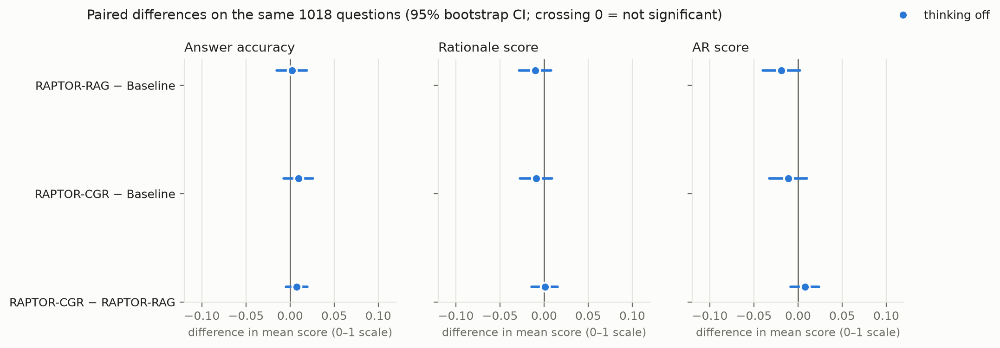
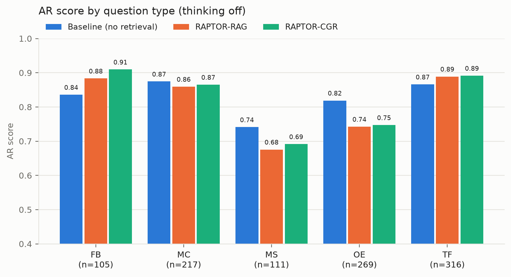
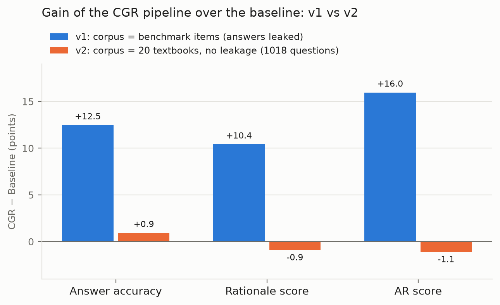

# Final evaluation: RAPTOR and RAPTOR-CGR on all 1,018 GraphRAG-Bench questions

*Run 19 Nov 2026 · answering model DeepSeek `deepseek-flash` (thinking off) · judge `deepseek-v4-pro`
· retrieval: RAPTOR trees over the 20 GraphRAG-Bench textbooks · total API cost US$3.62*

## Abstract

This is the leak-free re-evaluation of the project's method on the **full benchmark**. RAPTOR trees
were built from the 20 GraphRAG-Bench textbooks: 128,030 nodes, made of 116,184 text chunks and
11,846 LLM cluster summaries. No benchmark question, answer or rationale was indexed. Three pipelines
were compared on identical questions, as in the final report:

- **Baseline:** DeepSeek with no retrieval.
- **RAPTOR-RAG:** RAPTOR collapsed-tree retrieval, top 10 nodes.
- **RAPTOR-CGR:** RAPTOR-RAG plus chain-of-thought and context-grounding instructions.

| | Answer accuracy | Rationale score | AR score |
|---|---|---|---|
| Baseline | 0.886 | **0.873** | **0.838** |
| RAPTOR-RAG | 0.888 | 0.863 | 0.820 |
| RAPTOR-CGR | **0.895** | 0.864 | 0.827 |

**None of the nine overall comparisons is statistically significant** (paired bootstrap, Holm
correction). The design can detect differences of about 2.5 points in answer accuracy and 3 points in
AR. Retrieval **helps** fill-in-blank and true/false questions but **hurts open-ended questions**
(RAPTOR-RAG AR −7.6 points, Holm p = 0.012, the only effect that survives correction). The +12.5-point
answer gain of the submitted version (v1) does not reappear once the benchmark's own answers cannot be
retrieved.

## 1. Method

| Item | Setting |
|---|---|
| Questions | All 1,018 (FB 105 · MC 217 · MS 111 · OE 269 · TF 316) |
| Corpus | 20 textbooks, cleaned and split into 100-token chunks without changing the text ([common.py](../../src/common.py)) |
| RAPTOR tree | One tree per textbook: `all-MiniLM-L6-v2` embeddings, UMAP + GMM clustering, `deepseek-flash` summaries (≤ 100 tokens), 2 summary layers ([build_tree.py](../../src/build_tree.py)) |
| Retrieval | Collapsed tree: the 10 nodes (chunks or summaries) closest to the question, about 1,000 tokens ([retrieval.py](../../src/retrieval.py)) |
| Prompts | One shared answer format; each pipeline adds one ingredient ([prompts.py](../../src/prompts.py)) |
| Generation | `deepseek-flash`, temperature 0, thinking mode off, at most 2,048 tokens per answer |
| Judge | `deepseek-v4-pro` (larger model), sees the question, replies in JSON; MC/TF/MS scored by exact match |
| Metrics | GraphRAG-Bench answer, rationale and AR scores (18 items without an expert rationale count for answer accuracy only) |
| Statistics | Paired bootstrap (10,000 resamples), 95% CIs, Holm–Bonferroni within each family |
| Leakage audit | Expert rationale found verbatim in the retrieved context for **0.8%** of questions (v1: 96.8%). These are sentences the textbooks themselves contain |
| Guessing check | All 328 MC/MS questions re-asked to RAPTOR-CGR with the options shuffled |

Data and code: raw answers in [`results/raptor-1018/raw`](../../results/raptor-1018/raw), per-question
judgments in [`results/raptor-1018/judgments`](../../results/raptor-1018/judgments), and all tables in
[`results/raptor-1018/tables`](../../results/raptor-1018/tables).

## 2. Results

### 2.1 Overall performance



| Pipeline | Answer accuracy | Rationale score | AR score | Correct answer, wrong rationale |
|---|---|---|---|---|
| Baseline (no retrieval) | 0.886 | 0.873 | 0.838 | 1.4% |
| RAPTOR-RAG | 0.888 | 0.863 | 0.820 | 1.7% |
| RAPTOR-CGR | 0.895 | 0.864 | 0.827 | 1.3% |

### 2.2 Significance of the differences



| Comparison | Answer | Rationale | AR |
|---|---|---|---|
| RAPTOR-RAG − Baseline | +0.2 [−1.5, +2.0] | −1.0 [−2.8, +0.9] | −1.9 [−4.0, +0.3] |
| RAPTOR-CGR − Baseline | +0.9 [−0.7, +2.7] | −0.9 [−2.8, +0.9] | −1.1 [−3.2, +1.0] |
| RAPTOR-CGR − RAPTOR-RAG | +0.7 [−0.5, +2.0] | +0.1 [−1.5, +1.6] | +0.8 [−0.9, +2.4] |

Differences are in points, with the 95% bootstrap CI in brackets. All Holm-adjusted p-values are ≥ 0.83.
The smallest effect detectable with 80% power is about 2.4–2.5 points (answer), 2.6 (rationale) and
3.0 (AR) against the baseline, and about 1.8–2.3 points between the two RAPTOR pipelines.

### 2.3 By question type



| Type | n | Baseline (Acc / Rat / AR) | RAPTOR-RAG (Acc / Rat / AR) | RAPTOR-CGR (Acc / Rat / AR) |
|---|---|---|---|---|
| Fill-in-blank | 105 | 0.881 / 0.900 / 0.836 | 0.890 / 0.914 / 0.883 | **0.924 / 0.929 / 0.910** |
| Multiple choice | 217 | **0.912** / **0.888** / **0.874** | **0.922** / 0.872 / 0.859 | 0.903 / 0.877 / 0.865 |
| Multi-select | 111 | 0.775 / **0.838** / **0.741** | 0.788 / 0.784 / 0.676 | **0.811** / 0.775 / 0.691 |
| Open-ended | 269 | **0.916 / 0.870 / 0.819** | 0.874 / 0.836 / 0.742 | 0.887 / 0.832 / 0.747 |
| True/False | 316 | 0.883 / 0.867 / 0.866 | 0.911 / 0.890 / 0.889 | **0.918 / 0.891 / 0.891** |

Per-type paired tests (20 tests, Holm-corrected):

| Effect | Difference [95% CI] | p | Holm p |
|---|---|---|---|
| OE, RAPTOR-RAG − Baseline, AR | −7.6 [−12.2, −3.3] | 0.0006 | **0.012** |
| OE, RAPTOR-CGR − Baseline, AR | −7.2 [−12.1, −2.3] | 0.003 | 0.061 |
| OE, RAPTOR-RAG − Baseline, answer | −4.3 [−7.2, −1.3] | 0.004 | 0.072 |
| FB, RAPTOR-CGR − Baseline, AR | +7.4 [+1.0, +14.0] | 0.021 | 0.35 |
| TF, RAPTOR-CGR − Baseline, answer | +3.5 [+0.3, +6.6] | 0.037 | 0.59 |

### 2.4 By topic (AR score)

| Topic | n | Baseline | RAPTOR-RAG | RAPTOR-CGR |
|---|---|---|---|---|
| Data structures and algorithms | 121 | 0.719 | 0.785 | **0.789** |
| Computer networks | 119 | 0.869 | **0.907** | 0.897 |
| Cybersecurity | 112 | **0.879** | 0.757 | 0.812 |
| Information retrieval | 92 | **0.861** | 0.807 | 0.788 |
| Artificial intelligence introduction | 87 | 0.856 | **0.871** | 0.856 |
| Machine learning | 81 | **0.866** | 0.800 | 0.816 |
| Data science and big data | 66 | 0.706 | 0.782 | **0.798** |
| Mathematics | 62 | **0.915** | 0.839 | 0.847 |
| Computer architecture | 57 | 0.842 | 0.886 | **0.904** |
| Human-computer interaction | 50 | **0.820** | 0.720 | 0.750 |
| Computer vision | 44 | **0.926** | 0.818 | 0.784 |
| NLP | 37 | **0.932** | 0.791 | 0.824 |
| Mathematics (for CS and AI) | 34 | **0.941** | 0.897 | 0.912 |
| Programming fundamentals | 22 | 0.818 | **0.932** | **0.932** |
| Database systems | 15 | 0.786 | 0.786 | **0.857** |

Topics with fewer than 10 questions are in [by_topic.csv](../../results/raptor-1018/tables/by_topic.csv).
Retrieval helps most where the baseline is weakest (data structures and algorithms, data science,
programming fundamentals). It hurts topics the model already knows well (computer vision, NLP, mathematics).

### 2.5 Real understanding or guessing?

| Check | Result |
|---|---|
| Chance level | MC 25%, TF 50%; all pipelines are far above (MC ≈ 0.91, TF ≈ 0.88–0.92) |
| Correct answer but rationale judged wrong | 1.3–1.7% |
| Option-shuffle re-test (RAPTOR-CGR, 328 MC/MS) | accuracy 0.872 → 0.860 after shuffling; **90.2%** chose the same option in both orders, and 80.5% were correct both times |

The model's choices follow the content of the options, not their position.

### 2.6 Comparison with the submitted version



| RAPTOR-CGR − Baseline | Answer | Rationale | AR |
|---|---|---|---|
| v1 (corpus = benchmark items, leaked) | +12.5 | +10.4 | +16.0 |
| v2 (corpus = textbooks, this run) | +0.9 | −0.9 | −1.1 |

The two versions differ in model version and judge, so absolute scores are not comparable. The *gains*
are measured within each version on identical questions.

## 3. Discussion

1. **Ceiling effect.** The no-retrieval baseline already reaches 88.6% answer accuracy. Standard CS
   textbook knowledge is part of current LLMs, and GraphRAG-Bench (2025) may be in the training data,
   so retrieved passages add little new information on average.
2. **Retrieval helps precise recall.** Fill-in-blank and true/false questions often come straight from
   a textbook sentence; finding that sentence helps (FB AR +7.4 with CGR, TF answer +3.5).
3. **Retrieval hurts open-ended answers.** With RAPTOR, 35 open-ended answers became worse and only 11
   better. Two failure modes appear when inspecting them:
   - **Topic drift:** the answer follows the retrieved passage instead of the question. Asked how
     computer vision is used in autonomous vehicles, the model described the 1970s Stanford Cart
     because that is what the passage covered.
   - **Over-trust in the context:** when the passage lacked a concept, the model denied it existed
     ("there is no Principle of Effectiveness…").
4. **CGR vs plain RAG.** Chain-of-thought and grounding give a small, non-significant improvement over
   RAPTOR-RAG on every metric (+0.7 / +0.1 / +0.8). The grounding instruction did not prevent drift,
   which suggests the problem is in retrieval relevance more than in the prompt.

**Implication.** For a strong modern model, the value of textbook retrieval is not higher average
accuracy. It is help on precise, textbook-phrased questions and **verifiable citations**. A practical
system should retrieve selectively: use it for factual and terminology questions, and give open-ended
questions the model's own answer with sources attached.

## 4. Threats to validity

- **Judge from the same model family** (`deepseek-v4-pro` grading `deepseek-flash`); no second-family
  judge was run because of budget.
- **Model drift:** hosted models change over time; these results hold for the versions available on
  19 Nov 2026.
- **Two upstream RAPTOR failures** occurred on CLRS: infinite recursion on unsplittable clusters, and a
  GMM covariance error. Both are handled by a guarded clustering that matches upstream on normal data
  (tested). In the final run, the guard grouped 119 unsplittable CLRS clusters by text order; the GMM
  retry fallback was never needed.
- **Multiple comparisons:** per-type and per-topic results are exploratory except where Holm-corrected.

## 5. Reproduce

```bash
export EXPERIMENT=raptor-1018 JUDGE_MODEL=deepseek-v4-pro
python src/build_tree.py                          # one-off, ~US$2 (summaries)
python src/retrieval.py --index raptor && python src/check_leakage.py --index raptor
for p in baseline pure cgr; do python src/run_pipeline.py --pipeline $p; done
python src/run_pipeline.py --pipeline cgr --shuffle-seed 1
python src/evaluate.py && python src/make_report.py --judge deepseek-v4-pro
python src/make_figures.py --out evaluation-report/raptor-1018/figures
```

**Cost:** US$3.62 in total (DeepSeek balance 5.58 → 1.96). That is RAPTOR trees about US$2.1 (including
summaries lost in the first crash), answering about US$0.7 and judging about US$0.8. The tree is reusable,
so later reruns cost only answering and judging (about US$1.5 for all 1,018 questions).
