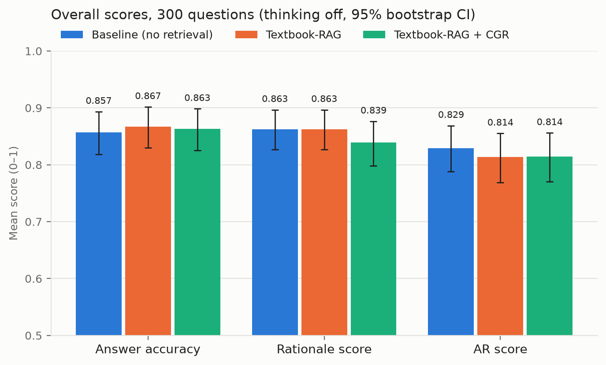
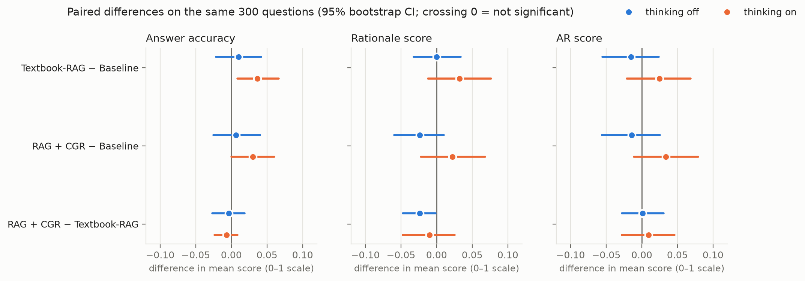
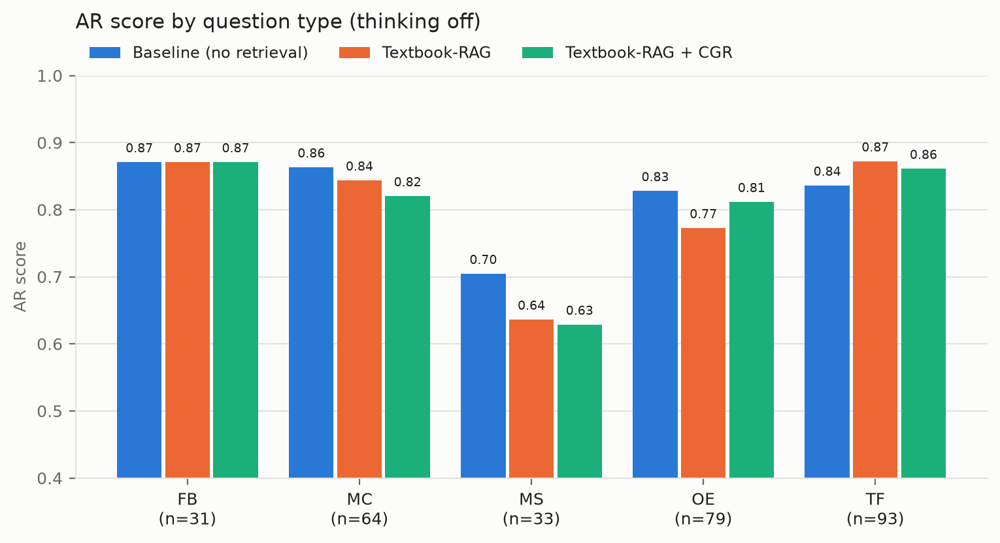
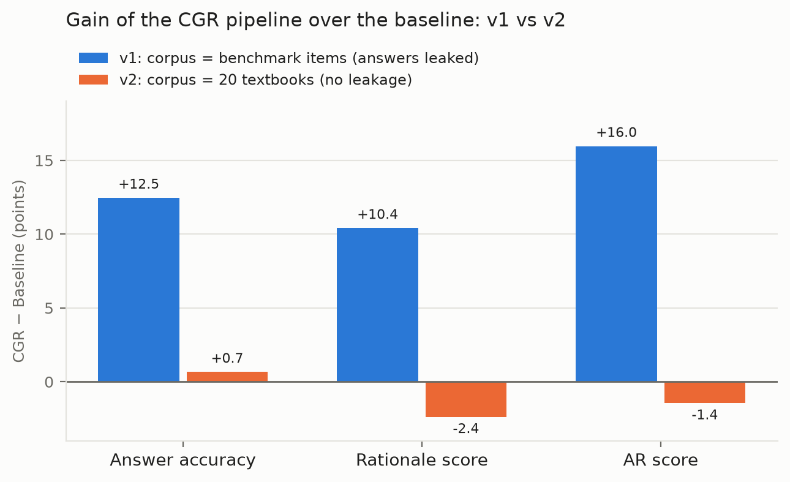
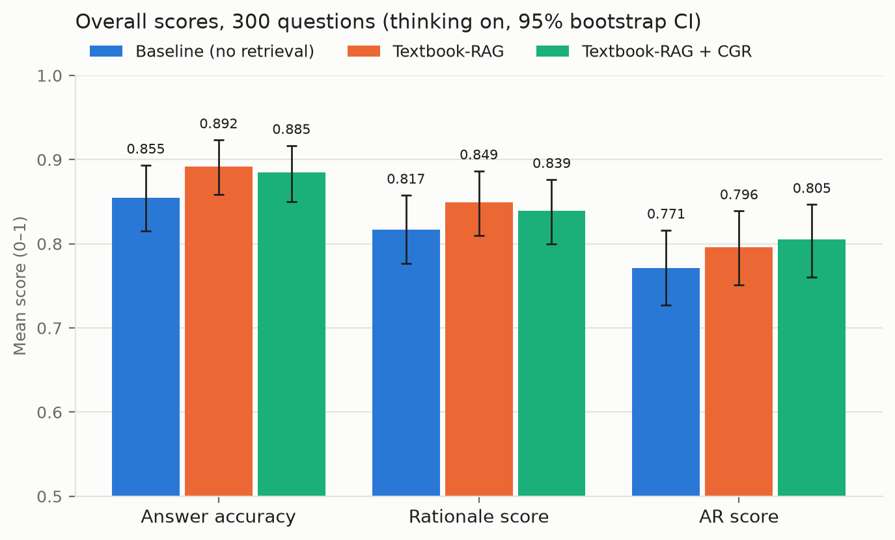

# Evaluation report: textbook retrieval and CGR on 300 GraphRAG-Bench questions

*Run 19 Nov 2026 · answering model `deepseek-flash` · judge `deepseek-v4-pro` · total API cost US$1.39*

## Abstract

We re-evaluated the project's method after fixing the answer leakage found in v1, where the retrieval
corpus contained the benchmark's own answers and expert rationales. Three pipelines were compared on the
same stratified sample of 300 GraphRAG-Bench questions:

- **Baseline:** DeepSeek with no retrieval.
- **Textbook-RAG:** the six most relevant passages from the 20 GraphRAG-Bench textbooks added as context.
- **Textbook-RAG + CGR:** the same passages plus chain-of-thought and context-grounding instructions.

All three reached similar scores: answer accuracy 0.857, 0.867 and 0.863, and AR score 0.829, 0.814
and 0.814. **No difference was statistically significant** after correcting for multiple comparisons.
With 300 paired questions, a true effect of about 4.5–6 points could be detected, so any real gain
from retrieval or CGR with this model is small. The +12.5-point gain reported in v1 is therefore best
explained by the leakage, not by the method.

## 1. Setup

| Item | Value |
|---|---|
| Questions | 300, stratified by type from the 1,018 (FB 31 · MC 64 · MS 33 · OE 79 · TF 93), seed 42 ([sample](../../data/samples/sample_300_seed42.json)) |
| Answering model | DeepSeek `deepseek-flash`, temperature 0, **thinking mode off** (main condition) |
| Retrieval corpus | 20 GraphRAG-Bench textbooks, 55,539 chunks, `multilingual-e5-small`, top 6 passages. **No RAPTOR summary trees** (budget), so the RAG pipelines are named Textbook-RAG, not RAPTOR |
| Prompts | One shared output format; each pipeline adds exactly one ingredient ([prompts.py](../../src/prompts.py)) |
| Judge | DeepSeek `deepseek-v4-pro` (a larger model than the answering model), thinking off, JSON replies. Every judgment is stored ([results/web-300/judgments](../../results/web-300/judgments)) |
| Metrics | GraphRAG-Bench answer score, rationale score and AR score ([how an answer is checked](../../README.md#how-an-answer-is-checked)) |
| Statistics | Paired bootstrap (10,000 resamples) with 95% CIs; Holm correction within each family of 9 comparisons |
| Leakage audit | Expert rationale found in the retrieved context for **1.0%** of questions (v1: 96.8%). These are sentences the textbooks themselves contain ([leakage.json](../../results/web-300/leakage.json)) |

Secondary condition: the same three pipelines with DeepSeek's **thinking mode on**. These answers were
produced first, by mistake, because of a bug that dropped the "thinking off" option (fixed and covered
by a regression test). They were kept as an extra experiment.

## 2. Results

### 2.1 Overall (main condition, thinking off)

| Pipeline | Answer accuracy | Rationale score | AR score | Correct answer but wrong rationale |
|---|---|---|---|---|
| Baseline (no retrieval) | 0.857 | 0.863 | **0.829** | 1.0% |
| Textbook-RAG | **0.867** | 0.863 | 0.814 | 0.7% |
| Textbook-RAG + CGR | 0.863 | 0.839 | 0.814 | 1.4% |



### 2.2 Are the differences real?



| Comparison (thinking off) | Answer | Rationale | AR |
|---|---|---|---|
| Textbook-RAG − Baseline | +1.0 [−2.2, +4.2] | 0.0 [−3.2, +3.4] | −1.5 [−5.5, +2.5] |
| RAG + CGR − Baseline | +0.7 [−2.5, +4.0] | −2.4 [−5.9, +1.2] | −1.4 [−5.6, +2.7] |
| RAG + CGR − Textbook-RAG | −0.3 [−2.7, +1.8] | −2.4 [−4.9, −0.2]* | +0.1 [−2.9, +3.1] |

Differences are in points, with the 95% bootstrap CI in brackets. *Nominal p = 0.048, Holm-adjusted
p = 0.43, so not significant. Every interval contains zero except one, and none survives the correction
for multiple comparisons.

**Power.** From the width of the paired intervals, the smallest effect this sample can detect (80% power,
α = 0.05) is about **4.5 points for answer accuracy and 5–6 points for AR**. Effects as large as the v1
claim (+12.5 / +16.0) would have been detected with near certainty.

### 2.3 By question type (AR score)



| Type | n | Chance | Baseline | Textbook-RAG | RAG + CGR |
|---|---|---|---|---|---|
| Fill-in-blank | 31 | – | 0.87 | 0.87 | 0.87 |
| Multiple choice | 64 | 0.25 | 0.86 | 0.84 | 0.82 |
| Multi-select | 33 | – | 0.70 | 0.64 | 0.63 |
| Open-ended | 79 | – | 0.83 | 0.77 | 0.81 |
| True/False | 93 | 0.50 | 0.84 | 0.87 | 0.86 |

Retrieval helps a little on true/false questions and hurts a little on multi-select and open-ended
questions. With 31–93 questions per type, none of these per-type differences is reliable on its own.
Inspection of individual changes suggests that retrieved passages sometimes distract the model on
calculation-style multiple-choice questions. Of the answers that flipped, 12 went from wrong to right
with retrieval and 6 from right to wrong.

### 2.4 Comparison with the submitted version (v1)



| CGR − Baseline | Answer | Rationale | AR |
|---|---|---|---|
| v1 (corpus = benchmark items, 1,018 questions) | +12.5 | +10.4 | +16.0 |
| v2 (corpus = textbooks, 300 questions) | +0.7 | −2.4 | −1.4 |

v1 and v2 also differ in model version (`deepseek-chat` in March 2026 vs `deepseek-flash` in November
2026) and in judge (self-judging vs `deepseek-v4-pro`), so the absolute levels are not comparable.
The **gain**, however, is measured within each version on identical questions, and it disappears once
the answers are no longer retrievable.

### 2.5 Secondary condition: thinking mode on

| Pipeline (thinking on) | Answer | Rationale | AR | Correct but wrong rationale | No `ANSWER:` tag |
|---|---|---|---|---|---|
| Baseline | 0.855 | 0.817 | 0.771 | 6.4% | 0 |
| Textbook-RAG | 0.892 | 0.849 | 0.796 | 6.1% | 0 |
| Textbook-RAG + CGR | 0.885 | 0.839 | 0.805 | 4.4% | 0 |



With hidden reasoning, the baseline's visible rationale is weaker: its AR is 5.8 points below the
thinking-off baseline (nominal p = 0.009, Holm 0.08). "Correct answer but wrong rationale" rises from
about 1% to 4–6%. In this condition retrieval raises answer accuracy by +3.7 points (nominal
p = 0.011, Holm 0.10), the largest effect in the study, but it is still not significant after correction.
Textbook passages may help most when the model reasons privately; this deserves a dedicated test.

*Correction (same day):* in thinking mode DeepSeek sometimes returned only the bare answer (e.g.
`A, C, D`) without the `ANSWER:` tag. These 21 answers were first scored as unanswered. The parser now
accepts a short one-line untagged reply as the answer, and they were re-judged. The main
(thinking-off) results were not affected: none of their answers lacked a tag for this reason.

## 3. Discussion

1. **Ceiling effect.** The baseline already answers 86% correctly. Current models have absorbed standard
   CS textbook knowledge, and GraphRAG-Bench (2025) may even be part of the training data, so retrieved
   passages add little information.
2. **Retrieval quality.** Only textbook chunks were retrieved. RAPTOR's cluster summaries, which help most
   on questions that need synthesis, were not tested here. The same 300 questions can be rerun with
   RAPTOR trees (see *Future work*).
3. **What CGR changes.** The grounding instruction ("base your answer on the context") makes the model
   lean on passages that are sometimes only partly relevant. This may explain the slightly lower
   rationale scores of CGR in both conditions.
4. **Implication for the web tutor.** Its value is not higher accuracy than the plain model, which this
   study does not support. Its value is **equal accuracy plus verifiable textbook citations**, in a
   format suited to studying.

## 4. Threats to validity

- **One judge model family.** `deepseek-v4-pro` grades `deepseek-flash`; self-preference bias may remain.
  Judge agreement with a second family (e.g. a non-DeepSeek model) was not measured because of budget.
- **Sample size.** 300 questions detect effects of about 5 points or more; smaller effects cannot be
  ruled out.
- **Model drift.** Hosted models change over time; results are tied to the model versions available on 19 Nov 2026.
- **The thinking-on condition was not planned.** It came from a bug and is reported separately as
  exploratory.

## 5. Reproduce

```bash
export EXPERIMENT=web-300            # everything below reads/writes results/web-300/
python src/make_sample.py --n 300 --seed 42
python src/retrieval.py --index web && python src/check_leakage.py --index web
for p in baseline pure cgr; do python src/run_pipeline.py --pipeline $p --sample data/samples/sample_300_seed42.json; done
JUDGE_MODEL=deepseek-v4-pro python src/evaluate.py
python src/make_report.py --judge deepseek-v4-pro && python src/make_figures.py
```

Raw answers: [`results/web-300/raw/`](../../results/web-300/raw). Per-question judgments:
[`results/web-300/judgments/`](../../results/web-300/judgments). All tables (CSV and Excel), with Holm-adjusted
p-values: [`results/web-300/tables/`](../../results/web-300/tables).

**Cost:** US$1.39 in total (DeepSeek balance 1.97 → 0.58, read after the usage page had caught up).
The per-run token estimates in `token_usage.csv` add up to about US$1.13 for the kept runs; the rest is
the invalid judging pass discarded because of the bug described in §1, plus the pilot.
