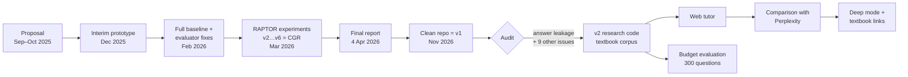
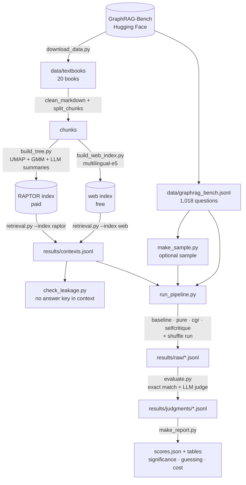
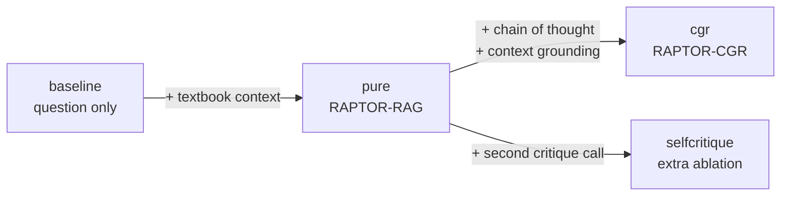
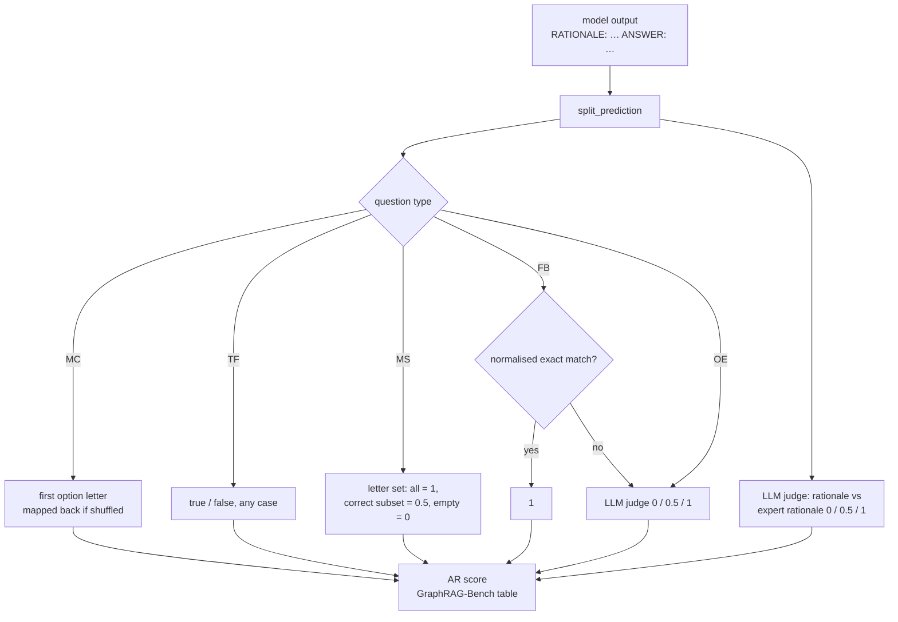
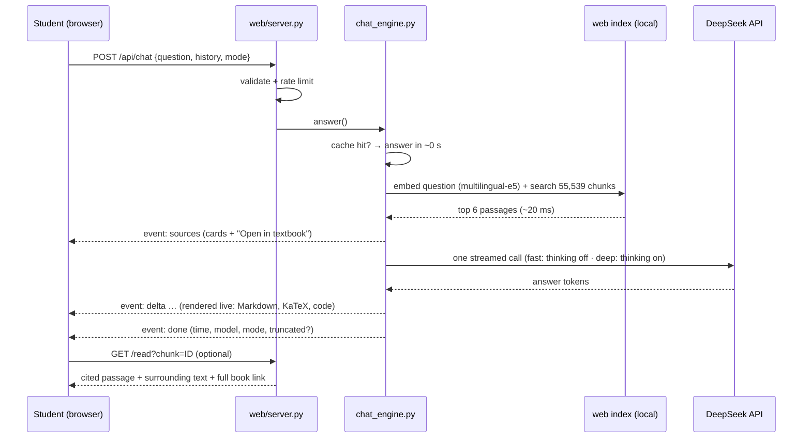
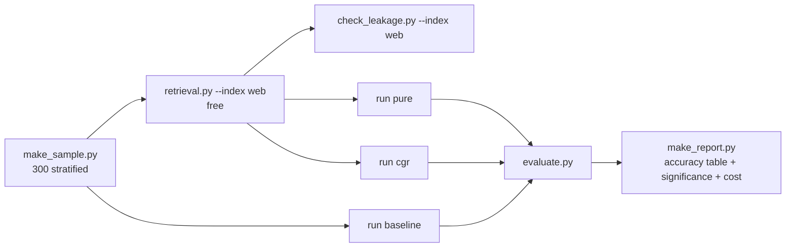

# Project structure and flowcharts

This page shows every folder and file in the repository, what each one is for, and how they connect.
For how the project developed and what went wrong along the way, see
[project-history](../project-history/README.md).

## 1. Folders and files

```
RAPTOR-CGR/
├── README.md                     overview, results, how to run
├── LICENSE                       MIT (code only)
├── requirements.txt              Python packages (tested with Python 3.11)
├── .env.example                  template for API keys and options (the real .env is never committed)
├── .gitignore
├── .claude/launch.json           dev-server shortcut (demo mode)
│
├── src/                          all Python code (run from the repository root)
│   ├── common.py                 paths, settings, dataset loading, question types, option shuffling,
│   │                             textbook cleaning (clean_markdown, fix_pdf_artifacts), split_chunks
│   ├── llm.py                    OpenAI-compatible client: retries, token counting, provider options
│   ├── prompts.py                every prompt: baseline, RAG, CGR, self-critique, judge
│   ├── scoring.py                answer parsing, exact/normalised scoring, AR score
│   │
│   ├── download_data.py          download the 20 textbooks; check the 1,018 questions match the release
│   ├── build_tree.py             RAPTOR tree per textbook (paid: ~13,600 summaries) -> data/trees, data/index
│   ├── build_web_index.py        free multilingual chunk index -> data/web_index
│   ├── retrieval.py              retrieved context for every question -> results/contexts.jsonl
│   │                             (--index raptor | web)
│   ├── check_leakage.py          proves no benchmark answer key is retrievable -> results/leakage.json
│   ├── make_sample.py            stratified question sample -> data/samples/
│   ├── run_pipeline.py           answer questions: baseline | pure | cgr | selfcritique (+ --sample, --shuffle-seed)
│   ├── evaluate.py               LLM-judge every answer -> results/judgments/
│   ├── make_report.py            scores, tables, significance, guessing checks, cost -> results/
│   ├── make_figures.py           report figures (PNG) -> evaluation-report/figures/
│   └── chat_engine.py            web tutor engine: search, grounded prompt, streaming, fallback, deep mode
│
├── web/                          the CS Textbook Tutor website
│   ├── server.py                 FastAPI: /api/chat (streaming), /read, /api/context, /books, rate limit
│   └── static/
│       ├── index.html, app.js    chat page
│       ├── read.html, read.js    "Open in textbook" reader
│       ├── render.js             Markdown + KaTeX maths rendering (shared)
│       └── style.css             light/dark, mobile
│
├── raptor/                       RAPTOR library (vendored from parthsarthi03/raptor, MIT, unmodified)
│
├── data/
│   ├── graphrag_bench.jsonl      the 1,018 GraphRAG-Bench questions (answer + expert rationale)
│   ├── book_titles.json          names of the 20 textbooks
│   ├── textbooks/                the 20 textbooks (Markdown, from GraphRAG-Bench)
│   ├── web_index/                55,539 chunks + embeddings used by the tutor and the budget evaluation
│   ├── samples/                  question samples (e.g. sample_300_seed42.json)
│   ├── trees/, index/            RAPTOR trees and flat index (built by build_tree.py; not committed)
│
├── results/
│   ├── contexts.jsonl            retrieved context per question (current run)
│   ├── leakage.json              leakage audit
│   ├── contexts_meta.json        which index produced contexts.jsonl (web or raptor)
│   ├── raw/                      answers of the 300-question run (thinking off; *-think = thinking on)
│   ├── judgments/                per-question scores from the deepseek-v4-pro judge
│   ├── tables/, scores.json      all result tables (CSV, Excel, summary.md)
│   └── v1/                       everything from the submitted version (tag v1-submitted)
│       ├── raw/                  model outputs of the 4 v1 pipelines
│       ├── eval_inputs/          evaluator-format questions and predictions
│       ├── scores.json, tables/  the numbers in the final report
│       └── question_tree.pkl     v1 RAPTOR tree (built from benchmark items: the leakage)
│
├── tests/                        76 offline tests (no API key needed)
│   ├── test_scoring.py           parsing, normalisation, MS partial credit, shuffles, AR
│   ├── test_cleaning.py          cleaning keeps every textbook; chunking keeps text; PDF artifacts
│   ├── test_retrieval.py         fast retriever == RAPTOR's own retriever
│   ├── test_llm.py               provider options (thinking mode) reach the API
│   ├── test_report.py            bootstrap, kappa, stratified sampling
│   ├── test_web.py               tutor engine + HTTP API + reader + deep mode
│   └── test_end_to_end.py        whole v2 workflow with a fake LLM
│
├── comparisons/                  tutor vs other AI assistants
│   └── shortest-paths/           vs Perplexity (Claude Sonnet 5.5 reasoning), with verify.py
│
├── evaluation-report/            leak-free 300-question evaluation: academic write-up + figures
├── project-history/              every stage, problem, severity and fix (proposal -> v2)
├── project-structure/            this page
└── docs/                         final report, presentation, summary
```

## 2. The whole project at a glance



## 3. Research pipeline (v2)



**Controlled ablation:** every pipeline uses the same output format and temperature 0, and each step
adds exactly one ingredient.



## 4. Scoring one answer



## 5. Web tutor: one question



## 6. Budget evaluation (300 questions, about US$0.3–0.7)


